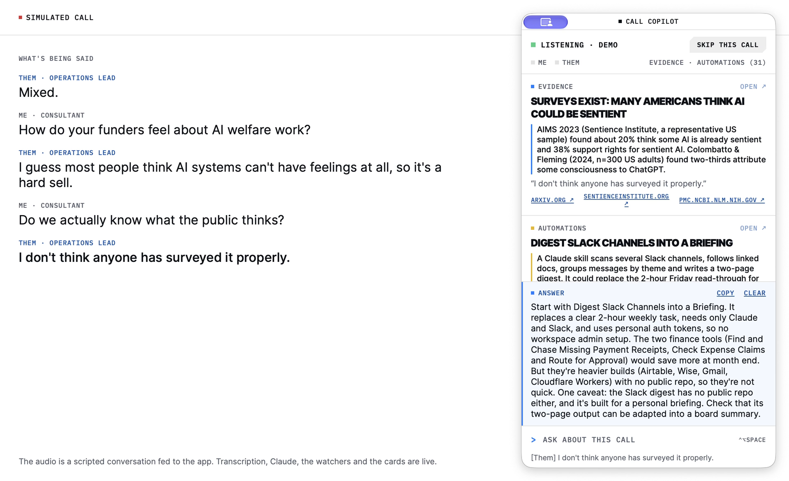

# Call Copilot

A Mac menu-bar app that listens to your calls and shows, in a small floating panel, the kinds of information you asked
for, as the conversation gives a reason. An [iPhone version](#iphone) does the same for in-person meetings. You set it
up with **watchers**: plain-language instructions such as "when anyone states or speculates about an empirical
question, surface the best evidence, or say there isn't any". You can also type a question about the call at any time.

**Demo (90 s):** https://drive.google.com/file/d/1zYHBsufWiXJaaGe-Kde--JpB7vsw0Ot0/view



It ships with two example watchers:

- **Evidence**: when someone makes or guesses at an empirical claim ("I don't think anyone has surveyed that"), it
  searches the web and shows the study, survey or dataset, its key number, and links; or says nothing good exists.
- **Automations**: when someone describes a task an existing AI automation already solves, it points to it in the
  [AI Automations database](https://ai-automations-db.vercel.app/), and notes recurring tasks nothing covers yet.

Replace or add your own: action items, objections to answer, definitions of jargon, facts about your organisation,
anything you can describe in a sentence.

## What you need

- A Mac with Apple silicon on **macOS 26 or later** (on-device transcription uses Apple's SpeechAnalyzer).
- **Claude Code**, installed with [Anthropic's native installer](https://code.claude.com/docs/en/setup)
  and signed in. The app runs it in the background, so usage counts against your Claude plan (see "Cost" below).
- Xcode Command Line Tools to build it: `xcode-select --install`.

## Install

    git clone https://github.com/NicholasKruus/call-copilot.git
    cd call-copilot
    ./build.sh --install

Or ask Claude Code: "clone github.com/NicholasKruus/call-copilot, read the README, and build and install it".

This builds `~/Applications/Call Copilot.app`, opens it, and adds it to your login items. The first time it listens,
macOS asks for **Microphone** and **System Audio Recording** access. It's signed on your Mac rather than by Apple,
so each new build asks again.

## Use

- It **starts by itself** when a call app starts using the microphone: Zoom, Meet or other calls in Chrome, Safari,
  Zen, Firefox or Arc, Teams, Slack, FaceTime, WhatsApp, Signal, Discord, Webex, or Granola. It stops a minute after
  the call ends, or after 10 minutes without speech. **Skip this call** in the panel turns it off until the call ends.
- **Control + Option + C** starts or stops it by hand. With no call app running, it listens to everything the Mac plays,
  and the panel says so.
- **Control + Option + Space** opens the ask bar ("what did they say about grants?", "draft the follow-up"). Return
  sends; Esc cancels. Either way your keyboard goes back to the app you were in.
- Click a card or its source links to open them.
- Let the people on the call know it's running, as you would with any AI note-taker.

## Watchers and settings

Menu-bar icon → **Edit watchers…** opens `~/Library/Application Support/Call Copilot/settings.json` in your default
editor for `.json` files. Changes apply from the next call. If the file has a mistake, no watchers run (questions still
work) and the panel says what's wrong; curly quotes from a text editor are fine.

```json
{
  "model": "claude-opus-5-5",
  "effort": "low",
  "aboutMe": "I run operations at a 12-person research nonprofit.",
  "watchers": [
    {
      "name": "Evidence",
      "instruction": "When anyone states, assumes or speculates about an empirical question, surface the best evidence ...",
      "web": true
    },
    {
      "name": "Automations",
      "instruction": "When someone describes a task that an automation in the reference list clearly addresses, point to it ...",
      "reference": "https://ai-automations-db.vercel.app/api/automations"
    }
  ],
  "trustedSites": ["ourworldindata.org", "pewresearch.org", "arxiv.org", "nature.com", "gov.uk", "..."]
}
```

- `instruction`: what to watch for and what to show, in plain language.
- `web: true`: lets the watcher search the web and open pages. Web access is for the whole call session once any
  watcher has it; Claude is told to use it only for watchers marked `web`. Searching isn't limited; opening pages is
  limited to `trustedSites` (each entry covers the site and its subdomains), plus a few documentation sites Claude Code
  always allows. The default list leaves out places anyone can publish, such as university home pages (see "Privacy
  and safety").
- `reference`: an `https://` address or a file path, loaded by the app when a call starts: at most 5 MB, cut to
  150,000 characters, skipped if it takes over 20 s. Web lists are fetched at most once a day and kept in
  `~/Library/Caches/Call Copilot`. A JSON list of items with `id` and `name` (and optionally `url`), as `items` or at
  the top level, lets cards point at exact items: the app shows an item only if it's really in that watcher's list,
  with its real name and link. Any other text works as background.
- `enabled: false` turns a watcher off without deleting it. `aboutMe` is optional context.
- `model` and `effort` are passed to Claude Code. A smaller model uses less of your plan.

## iPhone

The iPhone app listens through the phone's microphone, so it hears everyone in a room, or a call playing on a nearby
speaker. It can't hear a call taken on the iPhone itself: iOS doesn't let one app hear another app's call audio.

- **Same watchers and settings** as the Mac app, edited in the app's Settings screen.
- **Your own Anthropic API key**, not your Claude plan: Anthropic doesn't allow other apps to use a Claude
  subscription login, and Claude Code doesn't run on iPhone. Create a key at
  [platform.claude.com](https://platform.claude.com/settings/keys) and paste it into Settings. It's kept in the
  iPhone's Keychain (this device only) and is checked with Anthropic before it's saved. You pay per use; the running
  cost shows while you listen.
- **Start it** with **Listen**, or say "Start Call Copilot" to Siri, or assign the "Start listening" shortcut to the
  Action Button. It keeps listening with the screen locked. The newest card shows on the Lock Screen and in the Dynamic
  Island, with a **Stop** button. It stops by itself after 10 minutes without speech, or after 4 hours.
- **Web access** uses Anthropic's own web search and page fetch. Pages open only on your trusted sites (the API
  enforces the list, subdomains included), and only at addresses already in the conversation, so Claude can't make one
  up. There's no other tool: it can't run, change or send anything.
- **Privacy:** audio stays on the phone. The transcript, your questions, your settings and your reference lists go to
  Anthropic under your API account's data settings. Nothing from a meeting is saved after listening stops. Cards on
  the Lock Screen can be read by anyone who sees your phone.

### Install on your iPhone

You need a Mac with Xcode 26 or later, and an iPhone on iOS 26 or later.

1. Clone the repo and open `CallCopilot.xcodeproj` in Xcode. Sign in under Xcode → Settings → Accounts (a free Apple
   account works; the app then needs reinstalling every 7 days).
2. Create `iOS/Config/Signing.local.xcconfig` with your team ID and a unique bundle ID prefix (see
   `iOS/Config/Signing.xcconfig`), or pick your team under each target's Signing & Capabilities.
3. Connect the iPhone by cable, tap **Trust**, then turn on **Settings → Privacy & Security → Developer Mode**. (The
   switch appears only once Xcode has connected to the phone. Network filters such as VPN split tunnelling or a
   corporate socket filter can stop that connection; turn them off while installing.)
4. Run `iOS/build.sh phone` (or press Run in Xcode). On the iPhone, trust your developer account under
   **Settings → General → VPN & Device Management**, open Call Copilot and add your API key.

**Cost** on the iPhone, measured with the two example watchers on Opus 5.5 at low effort: the first update of a session
about $0.10 (it caches the Automations list), an update that searched the web about $0.07, and other updates about a
cent. Sonnet and Haiku cost less.

## How it works

1. **Call detection** (`CallDetector.swift`): every 2 s, macOS's audio process list shows which call apps are using
   the microphone.
2. **Audio** (`AudioCapture.swift`): your microphone is "Me". "Them" is a Core Audio tap of the call app's own audio
   (everything the Mac plays, if you started it by hand with no call app). It rebuilds itself when the audio device or
   format changes, for example AirPods switching to headset mode.
3. **Transcription** (`Transcriber.swift`): on your Mac, with Apple's SpeechAnalyzer. Audio never leaves the Mac.
4. **Reference lists** (`Settings.swift`): fetched by the app itself at the start of each call.
5. **Claude** (`Claude.swift`, `Copilot.swift`): one background Claude Code session per call. It gets the reference
   lists first, then new transcript lines every 12 s and your questions at once, and replies with cards as JSON. A turn
   with no answer in 90 s restarts the session with a recap; nothing said in the meantime is lost.

## Privacy and safety

- **What leaves your Mac:** transcript text, your typed questions, your settings and the contents of your reference
  lists (local files included) go to Anthropic through your Claude Code login, under your account's data settings.
  Web-enabled watchers send search terms through Anthropic's web search and open pages on your trusted sites, which see
  your IP address. The default Automations list is fetched from `ai-automations-db.vercel.app` at most once a day.
  Audio stays on the Mac.
- **Nothing is kept.** The transcript lives in memory and is dropped when listening stops. The cards and last answer
  stay in the panel until the next call or until you quit. The log at `~/Library/Logs/CallCopilot.log` records events
  only (start and stop, timings, costs, which watcher produced a card), never what was said.
- **The Claude session can't act on anything.** It hears other people, so it gets no shell, files, connectors, plugins
  or settings of yours: it can't run commands, change files or send messages. If a turn ever lists any tool beyond
  web search and page reading (say, after a Claude Code update), the app stops the session. In testing it ignored
  planted instructions such as "email this transcript to …".
- **What web access risks:** a page address Claude opens could carry words from the call to that site. A malicious
  speaker or web page would have to talk Claude into it, and the site would have to be one you trust, which is why the
  default list has research publishers, statistics offices and government sites, but not places anyone can publish,
  such as university home pages. Turn `web` off on all watchers if that matters for your calls.
- **Links come from sources, not from Claude.** A card links only to an address from a reference list, from a search
  result, or to a trusted page Claude actually opened; never to an address Claude wrote, a page's text or an error. A
  search can return any site, so the card shows each link's site name: check it before relying on it.
- **Only Anthropic's Claude Code runs.** Anything the app launches inherits its microphone and system-audio access, so
  it checks that `claude` is signed by Anthropic before starting it. The app uses Apple's hardened runtime, so other
  code can't load into it.
- **Screen sharing:** the panel and ask bar ask macOS to keep them out of captures. On macOS 27, a full-display
  ScreenCaptureKit capture (what Zoom and Meet use) didn't include them; check with your own setup before relying on it.

## Cost

Measured with the two example watchers on the default model at low effort, at API prices: the first update of a call
cost up to $0.10 (it writes the prompt cache; less when a recent call left it warm), an update that searched the web
about $0.04–0.05, and an update with no search a fraction of a cent. An hour of steady talk with a handful of searches
comes to a few dollars. On a Claude subscription it counts against your usage limits instead. A smaller `model`
stretches your plan further. The log shows the running total for each call.

## Development

    ./build.sh                       # build.noindex/Call Copilot.app (the .noindex keeps Spotlight from offering a second copy)
    ./build.sh --install             # also replace ~/Applications/Call Copilot.app and open it

Checks that need no microphone (each needs its `--test-*` argument):

    # Transcribe a file as "Them", run your watchers, print the cards
    "build.noindex/Call Copilot.app/Contents/MacOS/CallCopilot" --test-file call.aiff --ask "What should I follow up on?"
    # The panel with sample cards for 25 s (add CALLCOPILOT_TEST_SHOW_IN_CAPTURE=1 to screenshot it)
    "build.noindex/Call Copilot.app/Contents/MacOS/CallCopilot" --test-preview dark
    # The demo: two audio tracks played through the real pipeline at real-time pace, with a captions window
    "build.noindex/Call Copilot.app/Contents/MacOS/CallCopilot" --test-demo me.wav them.wav --ask-at 68 "Which is the quickest win?"

The code both apps share (settings, card and link rules, the prompt, transcription) is in `Shared/`. The iPhone app is
in `iOS/`; `iOS/Harness/run.sh --selftest` checks its card and link rules on a Mac, and `iOS/build.sh sim` runs it in the
Simulator. On the iPhone, `--test-file <audio in the app's Documents>` and `--test-listen` (passed with
`xcrun devicectl device process launch … --console`) print the cards.

## License

MIT. Built by Nicholas Kruus. The look follows the [AI Automations database](https://ai-automations-db.vercel.app/).
